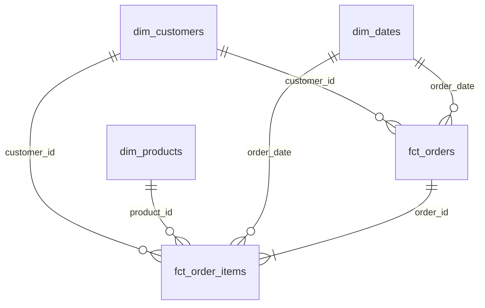
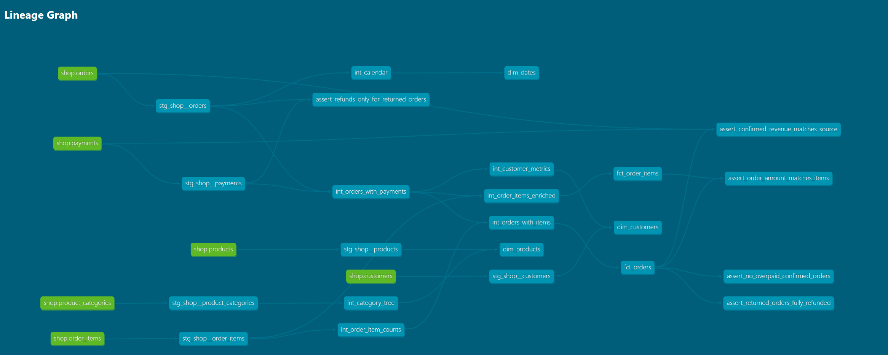

# Аналитические витрины интернет-магазина

Домашнее задание по DE, лекция 5.

За основу взят проект с семинара. Данные интернет-магазина сначала хранятся в PostgreSQL, затем через loader попадают в Greenplum. Дальше с помощью dbt из них собираются аналитические витрины.

Получается такой пайплайн:

`PostgreSQL → loader → Greenplum (raw) → dbt → analytics_marts`

## Запуск

Из корня проекта:

```bash
docker compose down -v
docker compose up -d
docker compose logs loader
```

В логах loader должна появиться строка `Готово`. После этого можно запускать dbt:

```bash
docker compose run --rm dbt build
```

Если образ dbt ещё не собран, сначала нужно выполнить `docker compose build dbt`.

Документация запускается отдельно:

```bash
docker compose run --rm dbt docs generate
docker compose run --rm --service-ports dbt docs serve --host 0.0.0.0 --port 8080 --no-browser
```

Открывается по адресу http://localhost:8080.

## Модель данных

Сделал две таблицы фактов и три измерения. Факты хранят информацию о заказах и их позициях, измерения — о клиентах, товарах и датах.



| Витрина | Одна строка | Для чего |
| --- | --- | --- |
| `fct_orders` | заказ | Выручка, средний чек, количество товаров |
| `fct_order_items` | позиция заказа | Выручка по товарам, категориям и брендам |
| `dim_customers` | клиент | Анализ покупателей по городам и каналам |
| `dim_products` | товар | Информация о товарах и иерархии категорий |
| `dim_dates` | день | Группировка данных по датам |

Модели разделены на три слоя:

- `staging` — исходные таблицы, переименование полей и приведение типов. Здесь нет соединений и агрегаций.
- `intermediate` — соединения таблиц, расчёт оплат, метрик клиентов и дерева категорий.
- `marts` — итоговые витрины, которые можно использовать для аналитики.

Подтверждённым считаю заказ со статусом `paid`, у которого есть хотя бы одна успешная оплата. Тестовые заказы в факты не попадают.

Сумма заказа считается по стоимости товаров с учётом скидок, а не по платежам. Это важно, потому что в данных встречаются повторные списания.

Для клиентов дополнительно считаются количество подтверждённых заказов, общая выручка и первая покупка. Первая покупка определяется по времени успешной оплаты, а если оно совпадает — по `order_id`. Клиенты без покупок тоже остаются в измерении.

## Хранение в Greenplum

Для фактов выбрал распределение по `order_id`, для небольших измерений — `replicated`.

| Витрина | Распределение | Хранение |
| --- | --- | --- |
| `fct_orders` | `distributed by (order_id)` | AO column |
| `fct_order_items` | `distributed by (order_id)` | AO column |
| `dim_customers` | `distributed replicated` | Обычная таблица |
| `dim_products` | `distributed replicated` | Обычная таблица |
| `dim_dates` | `distributed replicated` | Обычная таблица |

Обе таблицы фактов распределены по `order_id`, поскольку по нему они соединяются друг с другом. Так Greenplum не нужно пересылать данные между сегментами при таком JOIN. В исходных `raw.orders`, `raw.order_items` и `raw.payments` используется тот же ключ.

Колоночное хранение у фактов выбрал потому, что при анализе обычно нужны только отдельные столбцы, а не все сразу.

Измерения маленькие, поэтому проще хранить их копии на каждом сегменте.

Проверить распределение можно запросом:

```sql
select
    c.relname,
    pg_get_table_distributedby(c.oid) as distribution,
    am.amname as storage
from pg_class c
join pg_namespace n on n.oid = c.relnamespace
left join pg_am am on am.oid = c.relam
where n.nspname = 'analytics_marts'
  and c.relkind = 'r';
```

## Дополнительное задание

Выбрал вариант с инкрементальной моделью `fct_order_items`.

Для неё используются `materialized='incremental'`, `unique_key='order_item_id'` и `is_incremental()`.

При повторном запуске добавляются позиции заказов, у которых `order_id` больше максимального уже загруженного. Для наших данных это работает, поскольку новые заказы получают возрастающие ID.

Но есть недостаток: если поменять старый заказ или добавить к нему позицию, модель не увидит эти изменения. То же самое касается изменений статусов и платежей уже загруженных заказов.

Поэтому иногда нужно полностью пересобирать таблицу:

```bash
docker compose run --rm dbt run --full-refresh -s fct_order_items
```

## Тесты

Для ключей добавлены `unique` и `not_null`, для внешних ключей — `relationships`. Статусы проверяются через `accepted_values`.

Также написал свой generic-тест `non_negative`, который проверяет, что значение не отрицательное. Он используется для нескольких числовых колонок.

Отдельные SQL-тесты проверяют бизнес-логику:

1. Сумма заказа совпадает с суммой его позиций.
2. Количество и сумма подтверждённых покупок совпадают с расчётом по исходным таблицам.
3. По возвращённым заказам деньги полностью возвращены.
4. По подтверждённым заказам сумма списаний не превышает сумму заказа.

Оставил также проверку из семинара на то, что возвраты относятся только к возвращённым заказам.

### Найденная ошибка в данных

У заказа `113` сумма составляет 200 рублей, но по нему прошло два успешных платежа по 200 рублей.

Получается:
- `order_amount = 200`
- `paid_amount = 400`
- `net_paid_amount = 400`

Сам заказ не исправлял. Для теста `assert_no_overpaid_confirmed_orders` стоит `severity: warn`, поэтому dbt показывает предупреждение, а не ошибку.

При запуске `dbt build` получил:

`PASS=94 WARN=1 ERROR=0 SKIP=0`

То есть сборка проходит, единственное предупреждение — как раз по этому заказу.

## Проверка результатов

После сборки получил следующие количества строк:

| Таблица | Количество |
| --- | ---: |
| `raw.orders` | 141 |
| `raw.order_items` | 444 |
| `fct_orders` | 135 |
| `fct_order_items` | 425 |
| `dim_customers` | 40 |
| `dim_products` | 13 |
| `dim_dates` | 133 |

Из 135 заказов подтверждены 106, их общая сумма — **91 620 рублей**.

Из 40 клиентов хотя бы одну подтверждённую покупку совершили 29.

Для проверки использовал обычные запросы:

```sql
select
    count(*) as orders_count,
    count(*) filter (where is_confirmed) as confirmed_count,
    sum(order_amount) filter (where is_confirmed) as revenue
from analytics_marts.fct_orders;

select count(*)
from analytics_marts.fct_order_items;
```

Числа совпали с контрольными значениями из задания.

## Документация

Для моделей и колонок добавлены описания в YAML. Определение подтверждённой покупки вынесено в отдельный doc-блок.

Граф зависимостей моделей из dbt docs:



Папки `target`, `logs` и `dbt_packages` в репозиторий не добавляются, они указаны в `.gitignore`.